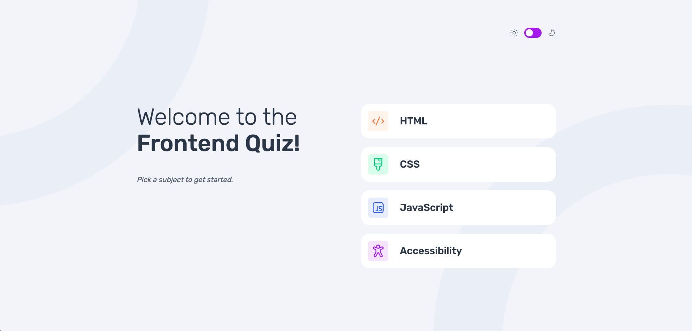

# Frontend Mentor - Frontend Quiz App Solution

This is my solution to the [Frontend Quiz App challenge on Frontend Mentor](https://www.frontendmentor.io/challenges/frontend-quiz-app-BE7xkzXQnU).

The project is an interactive quiz application built with HTML, CSS, and vanilla JavaScript. Users can choose a subject, answer multiple-choice questions, track their progress, and view their final score.

## Table of Contents

- [Overview](#overview)
  - [The Challenge](#the-challenge)
  - [Screenshot](#screenshot)
  - [Links](#links)
- [My Process](#my-process)
  - [Built With](#built-with)
  - [What I Learned](#what-i-learned)
  - [Continued Development](#continued-development)
  - [Useful Resources](#useful-resources)
  - [AI Collaboration](#ai-collaboration)
- [Author](#author)

## Overview

### The Challenge

Users are able to:

- Select a quiz category: HTML, CSS, JavaScript, or Accessibility.
- Answer multiple-choice questions.
- Select only one answer at a time.
- See an error message when submitting without selecting an answer.
- Receive visual feedback for correct and incorrect answers.
- See the correct answer when they make a mistake.
- Move to the next question after submitting an answer.
- Track their progress through a progress bar.
- View their final score.
- Restart the quiz and select another category.
- Switch between light and dark themes.
- Keep their selected theme after refreshing the page.
- Navigate the application using a keyboard.
- Use the application on desktop, tablet, and mobile devices.

### Screenshot



### Links

-[Solution URL](https://github.com/doomyhub229/-26Frontend-Quiz-app)
-[Live Site URL:](https://doomyhub229.github.io/-26Frontend-Quiz-app/)

## My Process

### Built With

- Semantic HTML5
- CSS3
- Flexbox
- CSS Grid
- Responsive Web Design
- CSS Media Queries
- JavaScript (ES6+)
- DOM Manipulation
- Event Listeners
- Fetch API
- Async/Await
- JSON
- Local Storage
- Accessibility (ARIA attributes and keyboard navigation)

### What I Learned

This project helped me improve my JavaScript skills and understand how to build an interactive application without using a framework.

**1. Working with asynchronous data**

I learned how to use the Fetch API and async/await to load quiz questions from a JSON file.

```js
async function loadQuiz() {
  const response = await fetch("./data.json");
  const data = await response.json();

  return data.quizzes;
}
```

**2. Managing application state**

I practiced using variables to track the selected quiz, current question, selected answer, and score.

```js
let selectedQuiz = null;
let currentQuestionIndex = 0;
let selectedAnswer = null;
let isAnswered = false;
let score = 0;
```

**3. Checking answers and calculating scores**

I learned how to compare the selected answer with the correct answer and update the score.

```js
if (selectedAnswer === correctAnswer) {
  selectedButton.classList.add("correct");
  score++;
} else {
  selectedButton.classList.add("incorrect");
}
```

**4. Preventing duplicate event listeners**

One important lesson was understanding why event listeners should not be repeatedly registered when starting a new quiz.

I organized the JavaScript so that the answer and submit button listeners are registered only once.

**5. Saving user preferences**

I learned how to use localStorage to remember the user's selected theme after refreshing the page.

```js
localStorage.setItem(
  "theme",
  isDark ? "dark" : "light"
);
```

**6. Improving accessibility**

I practiced using:

- `aria-pressed` for selected answers and the theme switcher.
- `aria-valuenow` for quiz progress.
- `tabindex="-1"` for programmatic focus management.
- `role="alert"` for validation messages.
- Disabled buttons to prevent changing submitted answers.

### Continued Development

In future projects, I want to improve my skills in:

- Writing cleaner and more reusable JavaScript functions.
- Managing application state in larger applications.
- Improving accessibility and keyboard navigation.
- Organizing CSS more efficiently.
- Building more complex interactive applications.
- Learning JavaScript modules and modern frontend frameworks.

### Useful Resources

- [MDN Web Docs](https://developer.mozilla.org/) - Helpful documentation for JavaScript, HTML, CSS, and browser APIs.
- [Frontend Mentor](https://www.frontendmentor.io/) - Provided the challenge, design files, and project requirements.
- [JavaScript.info](https://javascript.info/) - Useful explanations of JavaScript concepts.

### AI Collaboration

I used ChatGPT as a learning assistant and frontend development mentor throughout this project.

ChatGPT helped me:

- Understand JavaScript concepts.
- Debug issues with quiz scoring and event listeners.
- Improve the organization of my code.
- Implement theme persistence using localStorage.
- Improve accessibility and keyboard navigation.
- Review my HTML, CSS, and JavaScript.

I used AI guidance alongside hands-on coding, testing, and debugging to better understand how the application works.

## Author

- Frontend Mentor - [@doomyhub229](https://www.frontendmentor.io/profile/doomyhub229)
- GitHub - [@doomyhub229](https://github.com/doomyhub229)
## Acknowledgments

Thanks to Frontend Mentor for providing this challenge and helping developers improve their frontend skills through practical projects.
